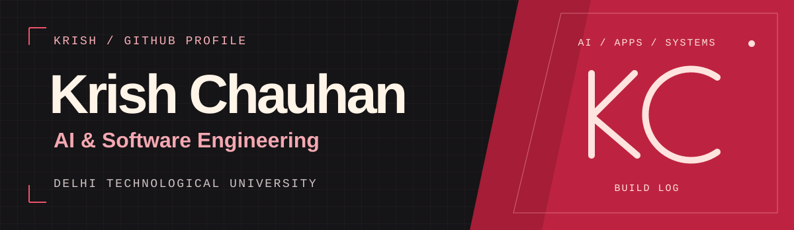
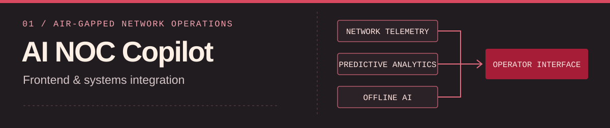

I’m Krish, a software engineering student at DTU. I like a good puzzle, especially when it ends in a working system. That’s taken me from computer vision to offline AI and aircraft telemetry.

**1st overall at CyberAI Cup 2026** across three tasks · **BAH grand finalist**, top 34 of 15,000+ submissions

## Featured build

I built the frontend and integrated the subsystems for an offline network operations copilot. Our BAH team, **bah bah black sheep**, brought network telemetry, predictive analytics, and an offline AI assistant into a single operator interface.

## Other work

**02 Seeing the Difference** 
I trained a Siamese network for CyberAI Cup Task 1 to spot meaningful differences between packaging designs and photos of the finished packaging. [Challenge brief](https://www.csmining.org/CyberAICup2026/data.html)

**03 Cyber-Threat Simulation Lab** 
A network security lab for generating traffic, processing datasets, and running threat detection scenarios. [Source](https://github.com/krish-chauhan-1108/AI-Based-Detection-of-Cyber-Threats-in-Unidirectional-IP-Traffic)

**04 Custom Data Link** · `IN PROGRESS` 
I’m building an aircraft telemetry and command protocol with packet framing, error detection, and retransmission.

More repositories

- [Vision-based force prediction](https://github.com/krish-chauhan-1108/FTF)
- [Legal RAG Advisor](https://github.com/krish-chauhan-1108/legal-rag-advisor)
- [Notion Clone](https://github.com/krish-chauhan-1108/final_notion_clone)

## Tools I reach for

**Models** `Python` `PyTorch` `OpenCV` `YOLO` `RAG` `LangGraph` 
**Apps** `TypeScript` `React` `Next.js` `FastAPI` `SQL` 
**Systems** `C/C++` `Linux` `Docker` `Wireshark` `AWS` `GitHub Actions`

---

Open to software internships and research collaborations. Away from the screen, I take photos, hike, and sing.
